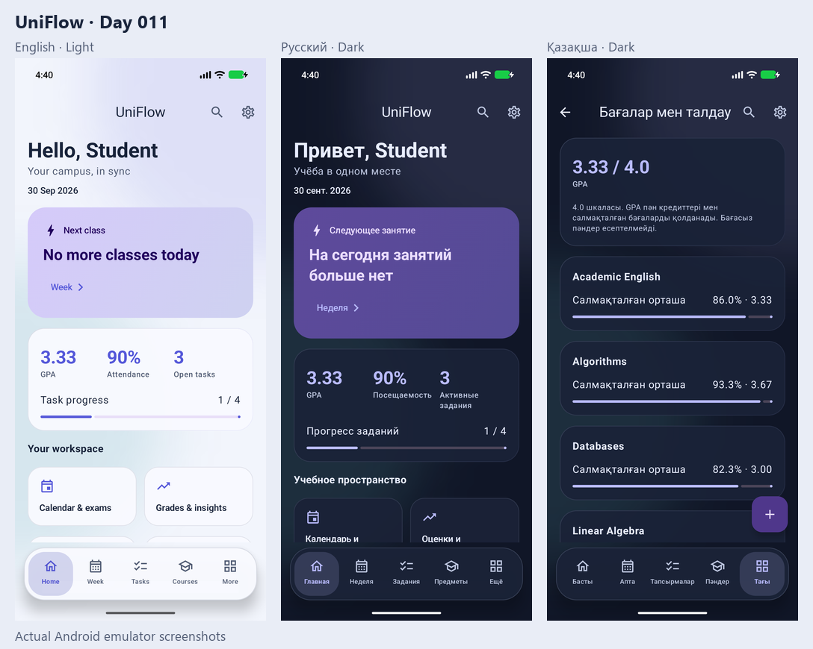
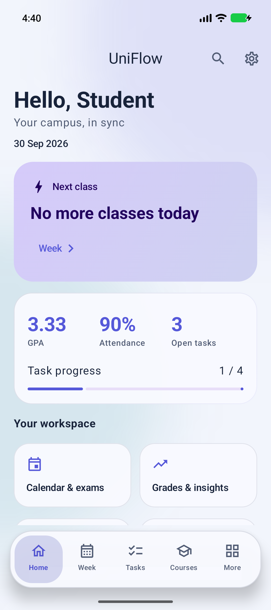
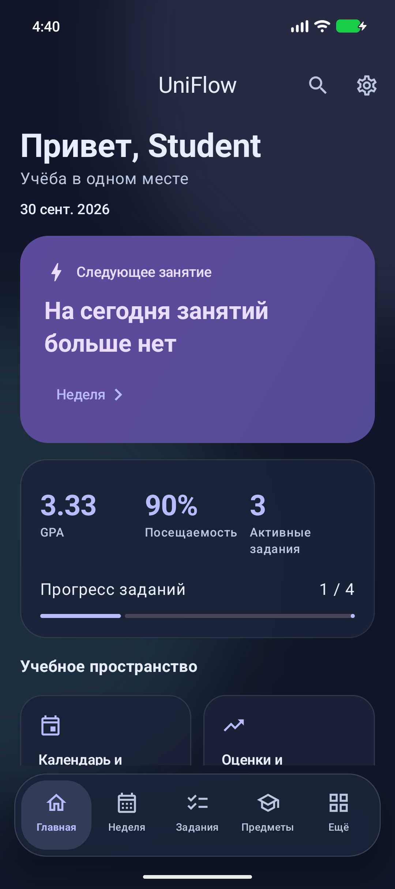
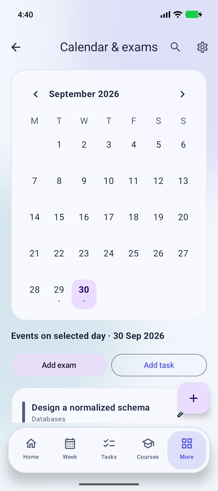
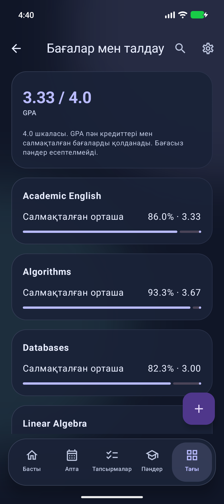

# UniFlow — Day 011 / 365 Days of Code

A local university workspace built with Kotlin and Jetpack Compose. English, Қазақша and Русский are available from Settings. No account, backend, API key or internet permission is required to use the app.

<!-- uniflow-screenshots:start -->
## Screenshots · Скриншоты · Скриншоттар

Actual Android emulator screenshots — English/light, Russian/dark and Kazakh/dark.



<details>
<summary>Full-size screenshots / Полные скриншоты / Толық скриншоттар</summary>

| English · Light | Русский · Dark |
|---|---|
|  |  |
|  |  |

</details>
<!-- uniflow-screenshots:end -->

## English

### Run in Android Studio

1. Unzip the archive and open the **UniFlow** folder, where `settings.gradle.kts` is located.
2. Use Android Studio Otter or newer, **JDK 17 or 21**, Android SDK **36** and SDK Build Tools **35.0.0**. Let Studio install missing SDK components and sync Gradle. The first sync needs internet access.
3. Choose an Android **8.0 / API 26+** emulator or device and run the `app` configuration.
4. Demo data is created once, in a database transaction, with dates relative to the first launch. Add your own courses and records, or edit the sample ones. Sample text is English and remains user-editable when the interface language changes.

Windows terminal:

```powershell
.\gradlew.bat assembleDebug testDebugUnitTest lintDebug
.\gradlew.bat connectedDebugAndroidTest
```

macOS / Linux:

```sh
chmod +x gradlew
./gradlew assembleDebug testDebugUnitTest lintDebug
./gradlew connectedDebugAndroidTest
```

`connectedDebugAndroidTest` requires a running emulator/device. Debug APK: `app/build/outputs/apk/debug/app-debug.apk`. Release builds use `assembleRelease`; configure your own signing key in Android Studio for distribution. No private signing key is included.

### Working features

| Area | Behavior |
|---|---|
| Dashboard | Today's classes, next ongoing/upcoming class, open tasks, completion progress, GPA, attendance and quick navigation |
| Timetable | Seven-day view, previous/next week, repeating weekly classes, rooms, time validation and overlap warning |
| Courses & teachers | Course CRUD, credit count, color, teacher name, email and office; a teacher directory derived from courses |
| Tasks | CRUD, priority, course filter, active/completed/overdue filters, completion and reopening |
| Calendar & exams | Month navigation, event markers, date selection, tasks and exams for a day, upcoming exams, times and rooms |
| Grades | CRUD, different score scales, weighted course averages, course filtering and credit-weighted GPA |
| Attendance | Dated records per course, present/absent toggle, counts and attendance percentage |
| Notes | Full text editor, optional course link, pinning and local text search |
| Global search | Case-insensitive search across courses, teachers, titles, descriptions and locations; results can be edited |
| Settings | Profile name, Light/Dark/System, English/Қазақша/Русский/System, permission-aware reminders and confirmed demo reset |

All records are saved in Room. Changes feed reactive `Flow` streams and immediately update dashboards and statistics. Forms validate titles, course selection, dates, class/exam time ranges, scores and credits. Delete actions ask for confirmation. Deleting a course also deletes all its linked records, including notes; the confirmation explains this explicitly. Weekly classes are recurring templates, not individual dated occurrences. Teacher contact details belong to a course and can be edited there; they are displayed in the Teachers directory.

### GPA rules

Each grade is normalized as `score / maximum × 100`. Course average is the weighted mean using each grade's positive weight. GPA is a credit-weighted mean of course grade points. Courses without grades are excluded, rather than counted as zero.

| Percentage, inclusive lower bound | Grade points |
|---|---|
| 95 / 90 / 85 / 80 | 4.00 / 3.67 / 3.33 / 3.00 |
| 75 / 70 / 65 / 60 | 2.67 / 2.33 / 2.00 / 1.67 |
| 55 / 50 / below 50 | 1.33 / 1.00 / 0.00 |

This is the app's documented grading scale; it may differ from your university's official calculation. Attendance counts only explicit attendance records; timetable entries do not imply attendance.

### Reminders and privacy

Reminders are off initially. Enable them in Settings and allow notifications on Android 13+. Task reminders are scheduled for 18:00 on the previous day; exam reminders for one hour before the exam. If the reminder time has passed but the deadline is still ahead, a reminder is queued immediately. WorkManager provides approximate background delivery; Doze, battery restrictions and force-stopping can delay jobs. It does not require exact-alarm permission. Editing, completing or deleting records rebuilds the jobs. The worker reads the current record and preferences before delivery; each record/date is notified once. Tapping a notification opens Tasks or Calendar. Keep the app open or reopen it after changing the device time zone to reschedule local times.

Data stays in the application sandbox. Automatic Android backup is disabled. Uninstalling or clearing app storage removes your data. This version has no cloud sync or export/import. Demo reset is destructive and asks for confirmation. Settings remain after a demo reset.

### Design and accessibility

Material 3 with indigo, teal and rose accents, rounded glass-inspired cards, blurred ambient background fields and an animated pill tab bar. Blur is restricted to decoration: no text or controls are blurred. On older Android versions, Compose renders the unblurred soft fields as a fallback. Surfaces are intentionally nearly opaque for readability. This is a liquid-glass-inspired Compose design, not an unsupported platform backdrop filter. Layouts scroll, respect system bars and the keyboard, and are constrained to a readable width on tablets. Icons used as actions have localized descriptions. Content and forms support system font scaling.

### Architecture

```text
app/src/main/java/dev/uniflow/app/
├── MainActivity.kt            # Compose host, runtime language configuration
├── UniFlowApplication.kt      # Application-scoped dependencies
├── data/
│   ├── Database.kt            # Room entities, DAO, foreign keys, indexes
│   ├── Preferences.kt         # DataStore settings and first-run marker
│   └── Repository.kt          # Persistence and transactional sample data
├── domain/Analytics.kt        # Pure validation, grade and attendance calculations
├── notifications/Reminders.kt # WorkManager scheduling and notification worker
└── ui/
    ├── StudyViewModel.kt      # MVVM state, coroutines, reactive flows
    ├── UniApp.kt              # Navigation Compose, editors, delete confirmations
    ├── Screens.kt             # Student workspace screens
    ├── Editors.kt             # Validated create/edit forms
    ├── SettingsScreen.kt      # Profile, language, theme, notification permission
    ├── Components.kt          # Shared glass cards and tab bar
    ├── Clock.kt               # Dashboard clock updates
    └── Theme.kt               # Material 3 light/dark palettes
```

Application-scoped manual dependency injection keeps this project easy to open without a generated DI framework. One shared ViewModel exposes immutable state and writes through the Repository. Courses are normalized; categorized records have nullable foreign keys with `ON DELETE CASCADE`. Room schema version 1 is committed in `app/schemas`. Add explicit migrations when changing persistent entities; destructive migration is not enabled.

Pinned toolchain: AGP 8.13.2, Gradle 8.13, Kotlin/Compose compiler 2.2.20, KSP 2.2.20-2.0.3, Compose BOM 2025.08.00, Room 2.8.5, Navigation 2.9.6, DataStore 1.2.1, WorkManager 2.10.1. These versions are pinned for reproducible builds. Gradle wrapper scripts and JAR are included.

### Verification

See `VERIFICATION.md` for commands actually run and their outcomes. Unit tests check weighting, normalization, GPA, attendance, grade-scale boundaries and validation. Instrumentation checks Room CRUD/cascade and Compose navigation. The ZIP excludes build output, caches, local SDK paths and secrets. `app/schemas` contains source-controlled database schema data, not build output.

Official references: [AGP compatibility](https://developer.android.com/build/releases/agp-8-13-0-release-notes), [Compose BOM](https://developer.android.com/develop/ui/compose/bom), [Room](https://developer.android.com/jetpack/androidx/releases/room), [WorkManager](https://developer.android.com/topic/libraries/architecture/workmanager).

## Қазақша

**UniFlow** — университеттегі оқу жұмысын бір жерге жинайтын офлайн Android қолданбасы. Бұл — **365 Days of Code, 011-күн** жобасы.

### Іске қосу

1. ZIP архивін ашып, Android Studio арқылы `settings.gradle.kts` орналасқан **UniFlow** қалтасын таңдаңыз.
2. Android Studio Otter немесе жаңарақ нұсқа, **JDK 17/21**, **Android SDK 36**, **Build Tools 35.0.0** қажет. Gradle синхрондауын аяқтаңыз; алғашқы жүктеуге интернет қажет.
3. **Android 8.0 / API 26+** құрылғысын немесе эмуляторын таңдап, `app` іске қосыңыз.
4. Алғашқы іске қосылғанда үлгі деректер автоматты түрде қосылады. Күндер алғашқы іске қосу күніне байланысты жасалады. Пәндер мен жазбаларды өзгертуге немесе жаңаларын қосуға болады.

Windows: `.\gradlew.bat assembleDebug testDebugUnitTest lintDebug`. macOS/Linux: алдымен `chmod +x gradlew`, содан кейін `./gradlew assembleDebug testDebugUnitTest lintDebug`. Құрылғыдағы тесттер үшін `connectedDebugAndroidTest` қолданыңыз. Debug APK: `app/build/outputs/apk/debug/app-debug.apk`.

### Мүмкіндіктер

- Басты экран: бүгінгі және келесі сабақ, тапсырма барысы, GPA, қатысу үлесі.
- Апталық кесте: күн таңдау, апта ауыстыру, қайталанатын сабақтар, уақыт пен аудитория, уақыттың қабаттасуын ескерту.
- Пәндер: қосу, өзгерту, жою, кредит пен түс, оқытушы аты, поштасы және кабинеті. Оқытушы мәліметтері пән арқылы өңделеді.
- Тапсырмалар: мерзім, басымдық, пән бойынша сүзгі, аяқтау және қайта ашу, мерзімі өткен жазбалар.
- Күнтізбе мен емтихандар: айды ауыстыру, оқиға белгілері, күн бойынша тапсырма мен емтихан, уақыт және орын.
- Бағалар: ұпай, максимум және салмақ, салмақталған орташа, кредитке тәуелді GPA.
- Қатысу: күн мен пән, қатысты/қатыспады белгісі, санақ және пайыз.
- Жазбалар: мәтін, пәнге қосымша байланыс, бекіту және іздеу. Жалпы іздеу пәндер мен оқытушыларды да қамтиды.
- Баптаулар: профиль аты, ашық/қараңғы/жүйелік тақырып, English/Қазақша/Русский/жүйелік тіл, хабарламалар және үлгі деректерді қалпына келтіру.

Деректер **Room**, баптаулар **DataStore** арқылы сақталады. **MVVM/Repository**, **Coroutines/Flow**, **Navigation Compose** және **WorkManager** қолданылады. Негізгі әрекеттер нақты деректермен жұмыс істейді. Пән жойылғанда оның барлық байланысты жазбалары да жойылады; бұл растау терезесінде көрсетіледі. Кестедегі сабақтар — апталық үлгілер. Үлгі мәтіндер ағылшынша, оларды өзгертуге болады; интерфейс тіліне автоматты аударылмайды.

GPA: баға `ұпай / максимум × 100` арқылы нормаланады; пәннің орташа бағасы жазба салмақтарын, GPA пән кредиттерін қолданады. Бағасыз пәндер есепке кірмейді. 95/90/85/80/75/70/65/60/55/50 шектері 4.00/3.67/3.33/3.00/2.67/2.33/2.00/1.67/1.33/1.00 ұпайға сәйкес, 50-ден төмен — 0. Бұл шкала университетіңіздің ережесінен өзгеше болуы мүмкін. Қатысу тек арнайы қосылған қатысу жазбаларынан есептеледі.

Еске салғыштар бастапқыда өшірулі. Баптауларда қосып, Android хабарламаларына рұқсат беріңіз. Тапсырма туралы алдыңғы күні 18:00-де, емтихан туралы бір сағат бұрын ескертіледі. WorkManager жеткізуі шамамен орындалады; Android қуат шектеулері кешіктіруі мүмкін. Мерзім әлі алда болса, өтіп кеткен еске салу уақыты үшін хабарлама кезекке бірден қойылады. Әр жазба/күн үшін бір хабарлама жіберіледі. Құрылғы уақыт белдеуін өзгерткен соң қолданбаны қайта ашыңыз.

Деректер құрылғыда сақталады; бұлттық синхрондау, импорт/экспорт және автоматты Android backup жоқ. Қолданбаны жою немесе деректерін тазалау деректерді өшіреді. Үлгі деректерді қалпына келтіру барлық оқу жазбаларын ауыстырады және растауды сұрайды.

Интерфейсте шыныға ұқсас карточкалар, жұмсақ фондық жарық пен анимацияланған төменгі панель бар. Бұлыңғырлау тек фонға қолданылады; мәтін анық қалады. Тексеру нәтижелері — `VERIFICATION.md`. Жоба MIT лицензиясымен беріледі.

## Русский

**UniFlow** — офлайн университетский ассистент для **Day 011 челленджа 365 Days of Code**.

### Запуск

1. Распакуйте ZIP и откройте в Android Studio папку **UniFlow** с файлом `settings.gradle.kts`.
2. Используйте Android Studio Otter или новее, **JDK 17/21**, **Android SDK 36**, **Build Tools 35.0.0**. Дождитесь синхронизации Gradle. Для первой загрузки зависимостей нужен интернет.
3. Выберите эмулятор или устройство **Android 8.0 / API 26+** и запустите конфигурацию `app`.
4. При первом запуске демоданные создаются автоматически и атомарно. Даты отсчитываются от первого запуска. Все примеры можно редактировать или удалить.

Windows: `.\gradlew.bat assembleDebug testDebugUnitTest lintDebug`. macOS/Linux: `chmod +x gradlew`, затем `./gradlew assembleDebug testDebugUnitTest lintDebug`. Тесты на подключённом устройстве: `connectedDebugAndroidTest`. Debug APK: `app/build/outputs/apk/debug/app-debug.apk`. Для публикации соберите release и настройте собственную подпись в Android Studio.

### Реализованные возможности

- Dashboard: занятия на сегодня, текущее/следующее занятие, ближайшие сроки, прогресс заданий, GPA и посещаемость.
- Расписание: семь дней, переключение недель, повторяющиеся занятия, аудитории, проверка времени и предупреждение о пересечениях.
- Предметы и преподаватели: CRUD предметов, кредиты, цвет, имя, email и кабинет преподавателя; справочник преподавателей формируется из предметов и редактируется через них.
- Задания: CRUD, приоритет, сроки, фильтры по предмету и статусу, просроченные задания, выполнение и возврат в работу.
- Календарь и экзамены: переключение месяцев, маркеры событий, выбор даты, задания и экзамены выбранного дня, ближайшие экзамены, время и аудитория.
- Оценки: CRUD, разные шкалы баллов, веса работ, средневзвешенные оценки, GPA с учётом кредитов и фильтрация по предмету.
- Посещаемость: записи по датам и предметам, переключение присутствия, количество посещений/пропусков и процент.
- Заметки: полный текст, необязательная привязка к предмету, закрепление, поиск. Глобальный поиск охватывает также предметы, преподавателей, записи и аудитории.
- Настройки: имя, Light/Dark/System, English/Қазақша/Русский/System, разрешение уведомлений и восстановление демоданных с подтверждением.

Данные сохраняются в **Room**, настройки — в **DataStore**. Архитектура **MVVM/Repository**, реактивное состояние **Coroutines/Flow**, навигация **Navigation Compose**, фоновые напоминания **WorkManager**. Изменения сразу обновляют статистику. Формы проверяют обязательные поля, даты, время, баллы и кредиты. Удаление требует подтверждения; удаление предмета каскадно удаляет связанные записи, в том числе заметки. Расписание содержит еженедельные шаблоны занятий. Демотексты написаны на английском и не переводятся автоматически при смене языка интерфейса.

### Расчёты и уведомления

Оценки нормализуются как `баллы / максимум × 100`. Средняя по предмету учитывает веса работ. GPA учитывает кредиты предметов; предметы без оценок исключаются. Нижние границы 95/90/85/80/75/70/65/60/55/50 соответствуют 4.00/3.67/3.33/3.00/2.67/2.33/2.00/1.67/1.33/1.00; ниже 50 — 0. Шкала описана явно и может отличаться от правил вашего университета. Посещаемость считается только по записям посещений, а не по расписанию.

Напоминания изначально выключены. Включите их в настройках и разрешите уведомления. Задания: накануне в 18:00. Экзамены: за час. Если время напоминания уже прошло, а срок ещё впереди, уведомление ставится в очередь сразу. WorkManager не гарантирует точное время: Doze, экономия батареи и принудительная остановка могут задержать доставку. На запись/дату отправляется одно уведомление. Изменение, завершение и удаление записи обновляют фоновые задания. Нажатие на уведомление открывает задания или календарь. После изменения часового пояса откройте приложение заново.

Интерфейс использует Material 3, полупрозрачные карточки с хорошим контрастом, размытые фоновые световые поля и анимированную нижнюю панель в стиле liquid glass. Текст и элементы управления не размываются. На старых версиях Android фон отображается без размытия. Это корректная имитация стеклянного оформления в Compose.

Данные остаются на устройстве. Облачной синхронизации и импорта/экспорта в этой версии нет, автоматический Android backup отключён. Удаление приложения или очистка его данных удаляет записи. Сброс демоданных заменяет учебные записи, сохраняя настройки. В архиве нет build, .gradle, local.properties и ключей. Результаты выполненных проверок описаны в `VERIFICATION.md`; схема Room включена в `app/schemas`. Лицензия MIT.
